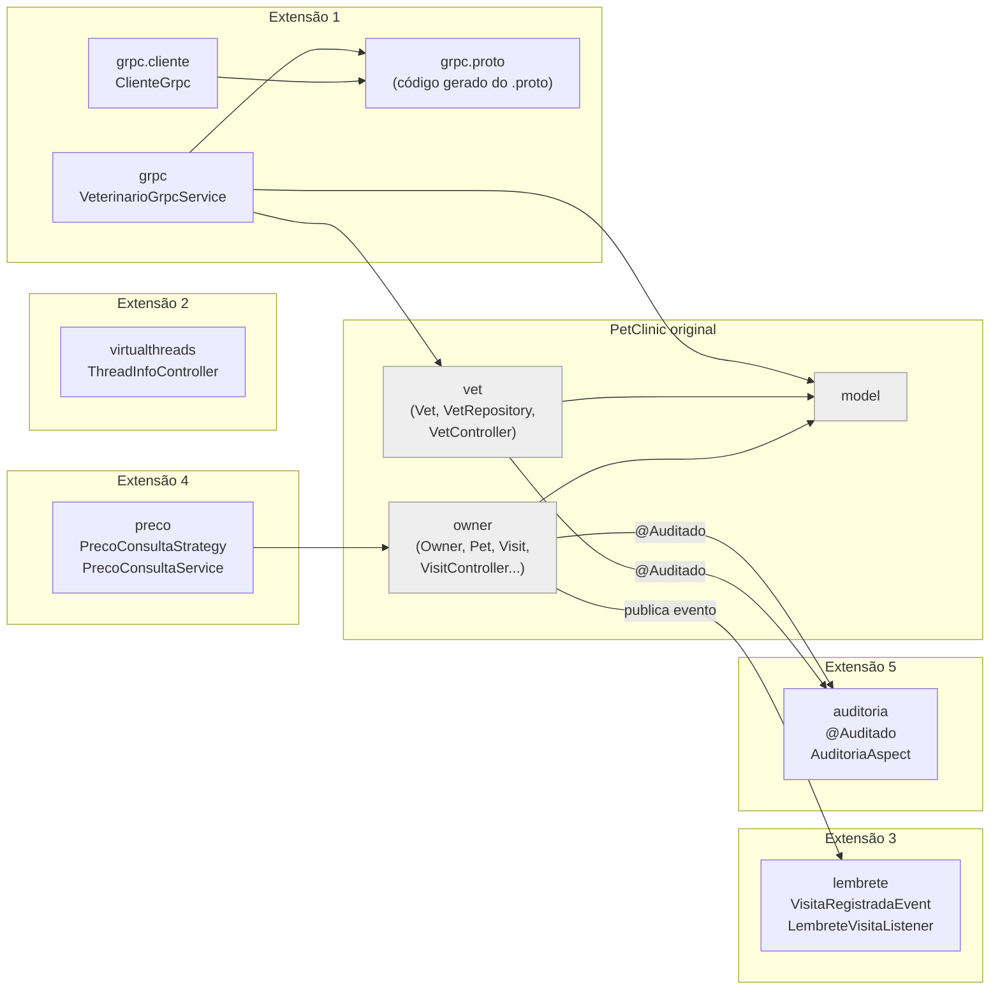
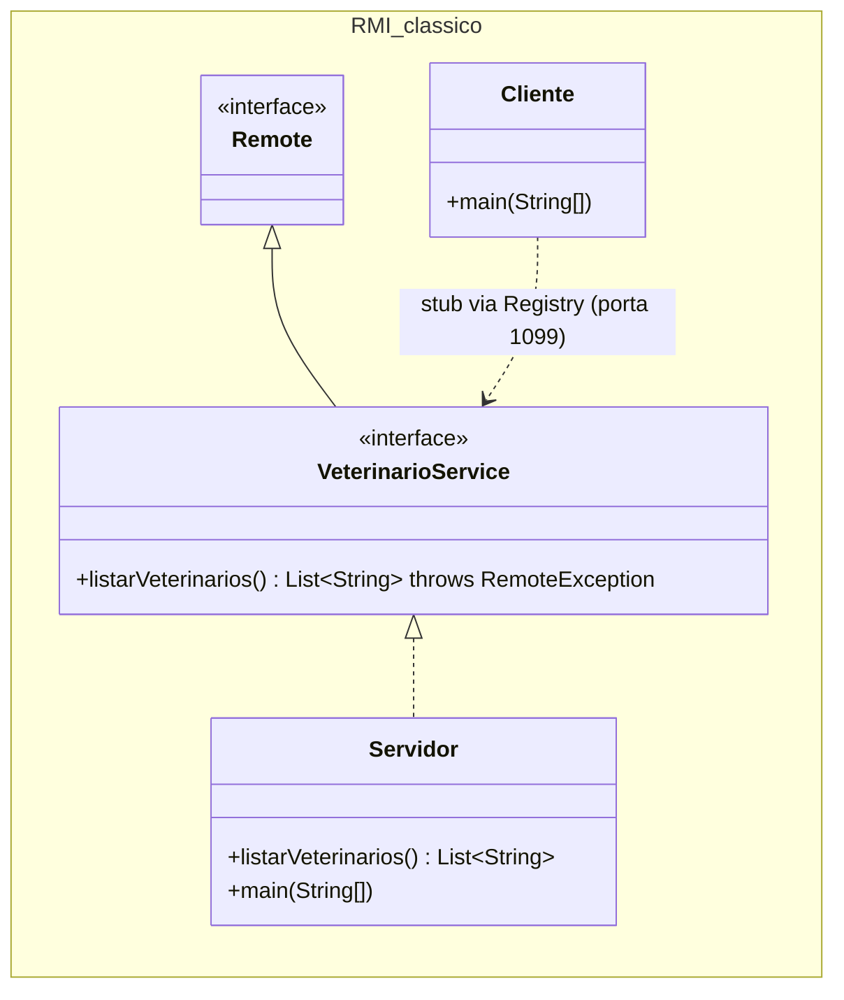
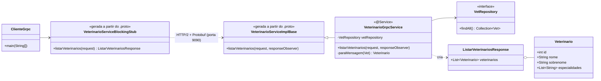
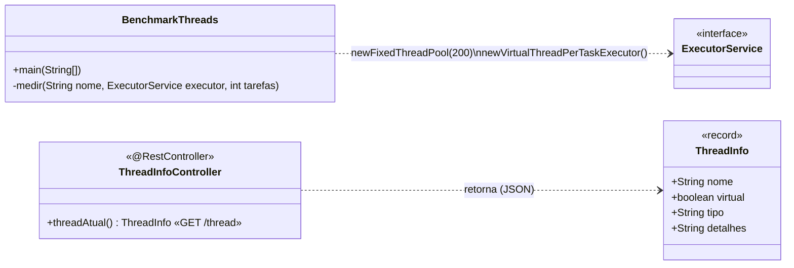
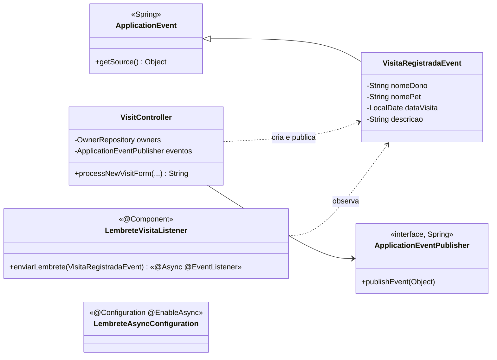
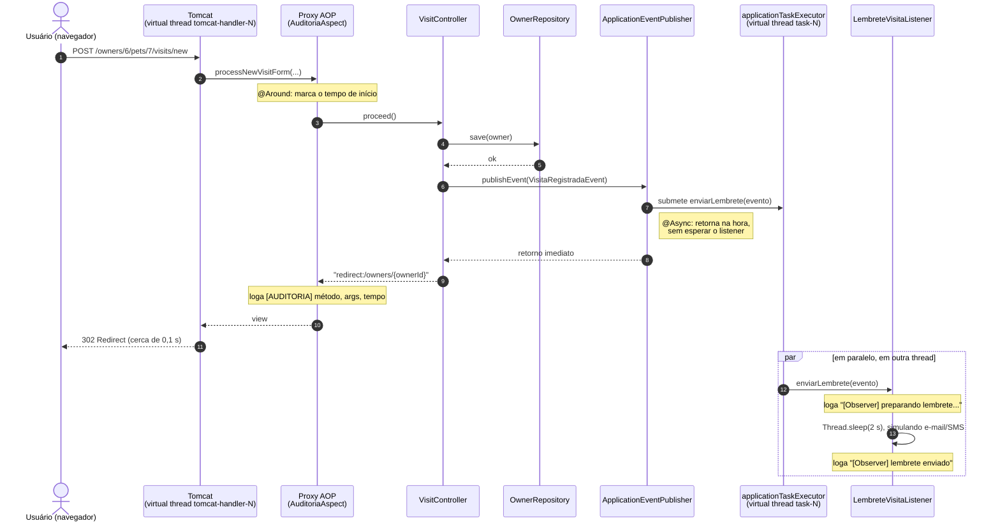
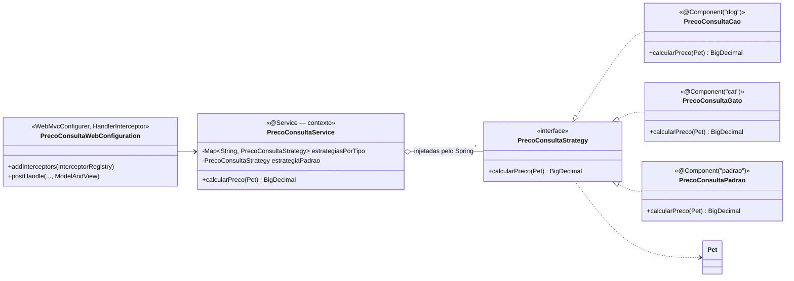
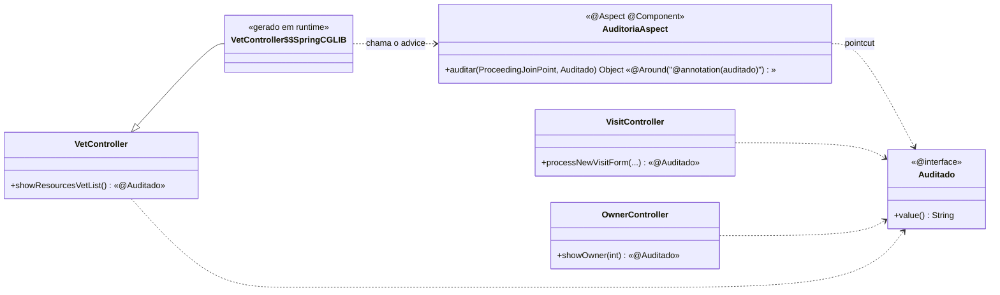

# Estudo de caso: Spring PetClinic (POO2, UFU)

Este fork do [spring-projects/spring-petclinic](https://github.com/spring-projects/spring-petclinic)
recebeu cinco extensões que cobrem os tópicos da disciplina ausentes no projeto original.
Em cada uma mostramos a **tecnologia clássica** ensinada na disciplina e o seu **equivalente moderno**.

| # | Extensão | Pacote / pasta | Branch |
|---|----------|----------------|--------|
| 1 | RMI (clássico) → gRPC (moderno) | `demos/rmi`, `...petclinic.grpc` | `extensao/1-rmi-grpc` |
| 2 | Threads de plataforma → Virtual Threads | `demos/threads`, `...petclinic.virtualthreads` | `extensao/2-virtual-threads` |
| 3 | Padrão Observer + processamento assíncrono | `...petclinic.lembrete` | `extensao/3-observer-async` |
| 4 | Padrão Strategy | `...petclinic.preco` | `extensao/4-strategy` |
| 5 | AOP próprio (`@Auditado`) | `...petclinic.auditoria` | `extensao/5-aop-auditoria` |

Todas as branches saem do mesmo commit base (atualização para Java 21) e não dependem umas
das outras. A branch `estudo-de-caso` junta as cinco.

**Pré-requisitos:** JDK 21 ou mais recente (necessário para as virtual threads). O projeto usa
Spring Boot 4.1.0. Se o `java -version` da máquina mostrar 17, aponte o `JAVA_HOME` para um JDK 21
antes de rodar o Maven:

```bash
# Git Bash / Linux / macOS
export JAVA_HOME=/caminho/para/jdk-21
# PowerShell
$env:JAVA_HOME = "C:\caminho\para\jdk-21"
```

> Nos comandos abaixo, `./mvnw` funciona no Git Bash, Linux e macOS. No PowerShell, use `.\mvnw`.

---

## 1. Diagrama de pacotes

O Mermaid não tem um diagrama de pacotes nativo, então cada pacote aparece como um
`subgraph`. As setas são dependências do tipo "usa". Os pacotes em cinza são do PetClinic original.



Pontos de contato com o código original. Nenhuma lógica de negócio existente foi alterada:

- `VisitController`: recebeu o `ApplicationEventPublisher` e uma chamada `publishEvent(...)` (Extensão 3),
  além de `@Auditado` em um método (Extensão 5).
- `OwnerController.showOwner` e `VetController.showResourcesVetList`: apenas `@Auditado` (Extensão 5).
- `createOrUpdateVisitForm.html` + `messages*.properties`: exibição do preço (Extensão 4).
- `application.properties`: `spring.threads.virtual.enabled=true` (Extensão 2).
- `pom.xml` / `build.gradle`: Java 21, starters de gRPC e AspectJ e geração de código protobuf.

---

## 2. Extensão 1: RMI → gRPC

**Clássico** (`demos/rmi`, 57 linhas, sem Spring e sem Maven): uma interface remota Java,
um servidor que publica o stub no RMI Registry e um cliente que procura o stub pelo nome.

**Moderno**: o contrato fica em `src/main/protobuf/veterinarios.proto`. No build, o Maven gera
as classes Java (`protobuf-maven-plugin`). `VeterinarioGrpcService` implementa o serviço reaproveitando o
`VetRepository` existente. O Spring Boot 4.1 sobe o servidor gRPC (Netty) na porta **9090**.
`ClienteGrpc` é um programa separado, sem Spring, que chama o serviço pelo stub gerado.





---

## 3. Extensão 2: threads de plataforma → Virtual Threads

**Clássico x moderno** (`demos/threads/BenchmarkThreads.java`): 10.000 tarefas com `Thread.sleep(1s)`,
primeiro em `newFixedThreadPool(200)` e depois em `newVirtualThreadPerTaskExecutor()`.
Resultado medido: **50.346 ms × 1.218 ms**.

**No PetClinic**: uma linha no `application.properties` (`spring.threads.virtual.enabled=true`)
faz o Tomcat atender cada requisição numa virtual thread. O executor do `@Async` também passa
a usá-las (veja a Extensão 3). O endpoint `GET /thread` mostra qual thread atendeu a requisição.



---

## 4. Extensão 3: padrão Observer + `@Async`

Quando uma visita é salva, o `VisitController` (o **sujeito**) publica um `VisitaRegistradaEvent`
(a **notificação**). O `LembreteVisitaListener` (o **observador**) recebe o evento numa
**outra thread** (`@Async`) e simula o envio de um lembrete, que leva 2 s. A resposta HTTP não espera esse envio.



### Diagrama de sequência: registrar visita → evento → lembrete assíncrono



---

## 5. Extensão 4: padrão Strategy

`PrecoConsultaStrategy` define o algoritmo. Cada implementação é um bean cujo **nome é o tipo de
pet** do banco (`"dog"`, `"cat"`), mais uma estratégia `"padrao"`. O `PrecoConsultaService` recebe
um `Map<String, PrecoConsultaStrategy>` **injetado pelo Spring** com todas as estratégias e faz
`getOrDefault(tipo, padrao)`, sem nenhum `if` ou `switch` sobre o tipo do pet. Para criar uma regra
para hamster, basta adicionar uma classe `@Component("hamster")`.

| Estratégia | Bean | Regra |
|---|---|---|
| `PrecoConsultaCao` | `dog` | R$ 100,00 + R$ 5,00 por ano de idade |
| `PrecoConsultaGato` | `cat` | R$ 90,00 |
| `PrecoConsultaPadrao` | `padrao` | R$ 70,00 (lagarto, cobra, pássaro, hamster...) |

O preço aparece na tela de nova visita. O `PrecoConsultaWebConfiguration` (um `HandlerInterceptor`)
adiciona `precoConsulta` ao model depois que o controller executa, sem alterar o `VisitController`.



---

## 6. Extensão 5: AOP próprio (`@Auditado`)

`@Auditado` é só um marcador. O `AuditoriaAspect` usa o pointcut `@annotation(auditado)` e um advice
`@Around` para registrar o método, os argumentos, o tempo e a thread. A anotação foi aplicada, **sem alterar
o corpo dos métodos**, em:

- `VisitController.processNewVisitForm` (`"Registrar visita"`)
- `OwnerController.showOwner` (`"Exibir dono"`)
- `VetController.showResourcesVetList` (`"Listar veterinários (JSON)"`)

**Weaving:** na inicialização, o Spring detecta que esses controllers têm métodos que casam com o pointcut
e registra no contexto um **proxy CGLIB** (uma subclasse gerada em tempo de execução) no lugar do objeto
original. O teste `AuditoriaAspectTests` comprova isso com `AopUtils.isAopProxy(...)`.



---

## 7. Clássico vs Moderno

| Clássico | Moderno | Por que foi substituído |
|---|---|---|
| **RMI** | **gRPC** | O RMI só funciona entre Java e Java: o contrato é uma interface Java e os dados usam **serialização Java**, que tem histórico grave de vulnerabilidades de desserialização. Ele usa a porta 1099 mais portas dinâmicas, o que dificulta firewalls, proxies e balanceadores. O gRPC mantém a ideia de "chamar um método remoto por um stub", mas o contrato `.proto` é **neutro de linguagem** (Java, C#, Go, Python...), os dados viajam em **Protocol Buffers** (binário compacto e com schema) sobre **HTTP/2** (multiplexação, streaming, TLS, compatível com infraestrutura web e nuvem) e o versionamento é explícito (campos numerados). |
| **Threads de plataforma** (pool fixo, `ExecutorService`) | **Virtual Threads** (Java 21) | Cada thread de plataforma é uma thread do sistema operacional: cerca de 1 MB de pilha, criação cara e um limite prático de poucos milhares por servidor. Em aplicações de I/O (banco, HTTP) as threads passam a maior parte do tempo bloqueadas, e o pool vira o gargalo. A alternativa anterior, a programação reativa, resolvia isso mas tornava o código difícil de ler e depurar. Virtual threads são gerenciadas pela JVM, custam poucos KB, podem existir aos milhões e **liberam a thread do SO ao bloquear**, então o código continua simples e bloqueante. No benchmark: 50 s → 1,2 s. |
| **AspectJ** (weaving em compilação ou load-time) | **Spring AOP** (proxies em runtime) | O AspectJ completo exige um compilador especial (`ajc`) ou um agente Java (`-javaagent`) para alterar o bytecode, o que complica o build, a IDE e a depuração. O Spring AOP reaproveita a **sintaxe de anotações do AspectJ** (`@Aspect`, `@Around`, pointcuts), mas faz o weaving com **proxies dinâmicos** (JDK Proxy ou CGLIB) na inicialização, sem ferramentas extras. O custo: só intercepta chamadas a métodos públicos de beans Spring que passam pelo proxy (chamadas internas via `this` não são interceptadas). Para a maioria dos *cross-cutting concerns* (transações com `@Transactional`, cache, segurança, auditoria), isso basta. |
| **Struts** (1 e 2) | **Spring MVC** (já usado pelo PetClinic) | O Struts 1 chegou ao fim de vida em 2013, e o Struts 2 acumulou vulnerabilidades críticas de execução remota de código via OGNL. A **CVE-2017-5638**, não corrigida a tempo, foi a porta de entrada do vazamento da **Equifax** em 2017, que expôs dados de cerca de 147 milhões de pessoas. O Spring MVC usa controllers como POJOs anotados (`@Controller`, `@GetMapping`), injeção de dependência, testes fáceis com MockMvc e integração com o ecossistema Spring Boot, além de ser mantido ativamente. |

---

## 8. Roteiro de demo

Preparação (antes da aula):

1. JDK 21 no `JAVA_HOME` (`java -version` deve mostrar 21).
2. `./mvnw -q -DskipTests package` para baixar dependências e gerar o código do gRPC (só na primeira vez).
3. Deixe 3 terminais abertos na raiz do projeto, mais o navegador.
4. No PowerShell, rode `chcp 65001` antes, para os acentos saírem certos na saída do Java/Maven.

### Passo 0: subir o PetClinic (terminal A)

```bash
./mvnw spring-boot:run
```

**Mostrar:** no log, `Tomcat started on port 8080` e
`gRPC Server started, listening on address: ... port: 9090`. A mesma aplicação expõe HTTP e gRPC.
**Deixe esse terminal visível**, porque os logs das Extensões 3 e 5 aparecem nele.

### Extensão 1: RMI → gRPC

1. **RMI puro** (terminal B):
   ```bash
   cd demos/rmi
   javac *.java
   java Servidor
   ```
   Mostrar: `Servidor RMI pronto na porta 1099`.
2. **Cliente RMI** (terminal C):
   ```bash
   cd demos/rmi
   java Cliente
   ```
   Mostrar: a lista de veterinários no C e `Chamada remota recebida na thread RMI TCP Connection(...)` no B.
   Abrir `VeterinarioService.java` e destacar `extends Remote` e `throws RemoteException`. Encerrar o servidor com Ctrl+C.
3. **gRPC**: abrir `src/main/protobuf/veterinarios.proto` (o contrato), depois `target/generated-sources/protobuf/...`
   (as classes geradas) e `VeterinarioGrpcService.java` (que usa o `VetRepository` existente).
4. **Cliente gRPC** (terminal C, na raiz do projeto, com o PetClinic rodando):
   ```bash
   ./mvnw -q exec:java@cliente-grpc
   ```
   Mostrar: `Veterinários recebidos via gRPC de localhost:9090` com id, nome e especialidades; no terminal A,
   `[gRPC] ListarVeterinarios recebido na thread grpc-default-executor-0`.
   > **Não** rode `./mvnw compile` com o app no ar: o DevTools reinicia a aplicação e o gRPC
   > fica fora por alguns segundos (`Connection refused`).
5. (Opcional, se tiver o [grpcurl](https://github.com/fullstorydev/grpcurl) instalado.) A reflection vem ligada, então outra
   linguagem e ferramenta enxergam o serviço sem nenhum código Java:
   `grpcurl -plaintext localhost:9090 list` e
   `grpcurl -plaintext localhost:9090 petclinic.VeterinarioService/ListarVeterinarios`.

### Extensão 2: Virtual Threads

1. **Benchmark** (terminal B):
   ```bash
   cd demos/threads
   java BenchmarkThreads.java          # cerca de 50 s + 1 s
   java BenchmarkThreads.java 2000     # versão curta: cerca de 10 s + 1 s
   ```
   Mostrar: `Pool fixo (200 threads de plataforma) ... ~50.000 ms` contra `Virtual threads ... ~1.200 ms`.
   Explicar que o código da tarefa é idêntico e só o `ExecutorService` muda.
2. **No PetClinic**: abrir `application.properties` e mostrar `spring.threads.virtual.enabled=true`.
3. No navegador: **http://localhost:8080/thread**. Mostrar:
   `{"nome":"tomcat-handler-0","virtual":true,"tipo":"virtual","detalhes":"VirtualThread[#60,tomcat-handler-0]/runnable@ForkJoinPool-1-worker-3"}`.
   Destacar `virtual: true` e a *carrier thread* `ForkJoinPool-1-worker-N` em `detalhes`.
   (Para contrastar: troque a propriedade para `false`, reinicie, e o nome passa a ser `http-nio-8080-exec-1` com `virtual: false`.)

### Extensões 3, 4 e 5: registrar uma visita

1. No navegador: **http://localhost:8080/owners/6/pets/7/visits/new?lang=pt**
   (dona Jean Coleman, gata Samantha).
   **Mostrar (Extensão 4):** `Preço da consulta: R$ 90,00`. Depois abra
   **http://localhost:8080/owners/3/pets/3/visits/new**: a cadela Rosy, nascida em 2011, aparece com
   `R$ 175,00` (100 + 15 × 5). Em **http://localhost:8080/owners/4/pets/5/visits/new**, o lagarto Iggy
   cai na estratégia padrão, com `R$ 70,00`. Abrir `PrecoConsultaService` e mostrar o `Map` injetado, sem nenhum `if`.
2. Volte para a Samantha, preencha a descrição (por exemplo, "Vacina anual") e clique em **Adicionar visita**.
   A página volta **na hora** com "Your visit has been booked".
3. **Mostrar no terminal A**, nesta ordem:
   - `[AUDITORIA] VisitController.processNewVisitForm(..) (Registrar visita) | args=[[Owner ... Coleman ...], 7, ...] | 50 ms | thread=tomcat-handler-5`
     (**Extensão 5**: o aspecto interceptou o método sem tocar no corpo dele);
   - `[Observer] Thread 'task-1' (virtual=true): preparando lembrete para Jean Coleman sobre a visita de Samantha em ...`
   - cerca de 2 s depois: `[Observer] Thread 'task-1': lembrete enviado para Jean Coleman (Vacina anual)`
     (**Extensão 3**: outra thread, `task-1` e não `tomcat-handler-N`, e a resposta HTTP não esperou os 2 s).
4. Mais duas chamadas auditadas: **http://localhost:8080/owners/1** e **http://localhost:8080/vets**
   (`[AUDITORIA] OwnerController.showOwner(..) (Exibir dono) | args=[1]` e
   `[AUDITORIA] VetController.showResourcesVetList() ... | args=[]`).
5. Abrir `AuditoriaAspect.java` e mostrar o pointcut `@annotation(auditado)`. Depois abrir `VetController.java` e
   mostrar que a única mudança é a linha `@Auditado(...)`.

### Encerrando: os testes

```bash
./mvnw test
```

Mostrar `Tests run: 92, Failures: 0, Errors: 0, Skipped: 2` e `BUILD SUCCESS`. Os 2 testes pulados são
os de MySQL via Testcontainers, que exigem o Docker em execução. Os testes de cada extensão:

| Extensão | Teste | O que prova |
|---|---|---|
| 1 | `grpc/VeterinarioGrpcServiceTests` | Uma chamada gRPC real (Netty, porta dinâmica) retorna os 6 veterinários do banco |
| 2 | `virtualthreads/ThreadInfoControllerTests` | Uma requisição HTTP real ao Tomcat é atendida por uma virtual thread |
| 3 | `lembrete/VisitaRegistradaEventTests` | O POST da visita publica o evento com os dados corretos e o listener roda em outra thread |
| 4 | `preco/PrecoConsultaServiceTests`, `preco/PrecoConsultaTelaTests` | Cada tipo de pet usa sua estratégia, e o preço aparece no HTML |
| 5 | `auditoria/AuditoriaAspectTests` | Os controllers viraram proxies AOP e o log traz método, argumentos e tempo |

---

## 9. Limitações e observações

- **Docker:** os testes `MySqlIntegrationTests` e `PostgresIntegrationTests` precisam do Docker e ficam pulados sem ele, como já acontecia antes das extensões.
- **Porta do gRPC nos testes:** `src/test/resources/config/application.properties` define `spring.grpc.server.port=0`, porque vários contextos Spring de teste ficam em cache ao mesmo tempo e brigariam pela 9090. Em execução normal a porta continua 9090.
- **Segurança do gRPC:** o servidor e o cliente usam texto puro (`usePlaintext()`), sem TLS e sem autenticação. Isso só é adequado para a demo local.
- **Preço da consulta:** o valor é apenas calculado e exibido. Ele não é gravado na visita (não houve mudança no schema do banco).
- **`@Auditado` e argumentos:** o log usa `toString()` dos argumentos. `Visit` não sobrescreve `toString()`, então aparece como `Visit@1a2b3c`. Em produção, cuidado para não logar dados sensíveis.
- **Spring AOP:** chamadas internas (um método do controller chamando outro via `this`) não passam pelo proxy e não são auditadas. Essa é uma limitação do modelo de proxies e um bom ponto de discussão com AspectJ.
- **Acentos no console do Windows:** sem `chcp 65001`, a saída do Maven/Java pode mostrar `Veterin�rios`. É só exibição; os dados estão corretos.
