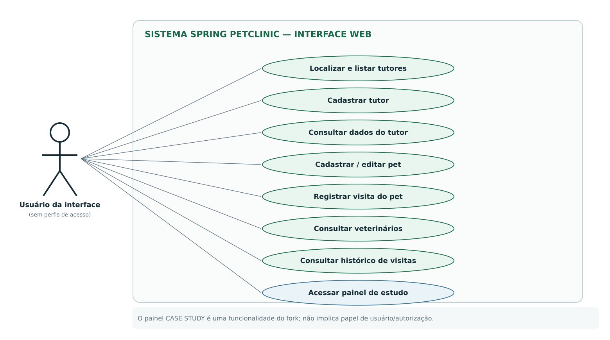
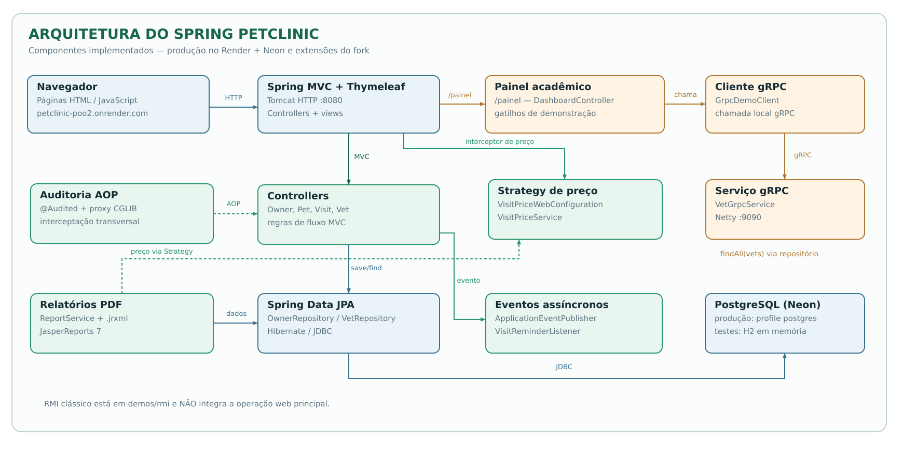
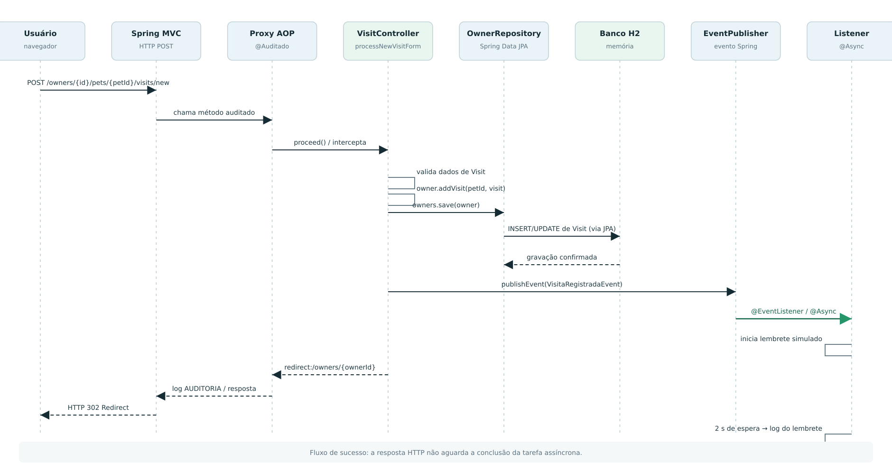
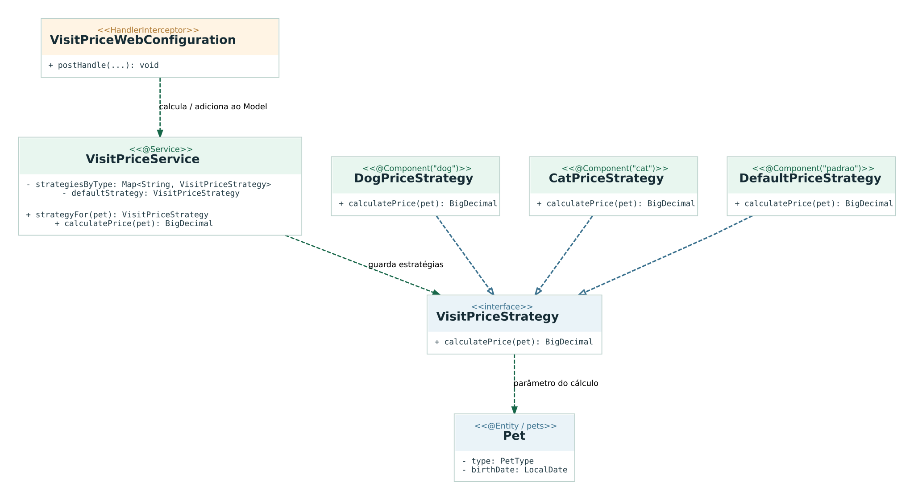
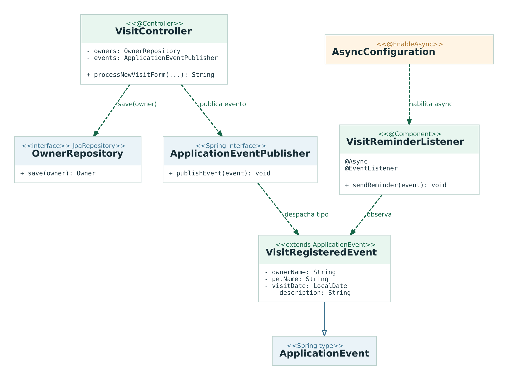
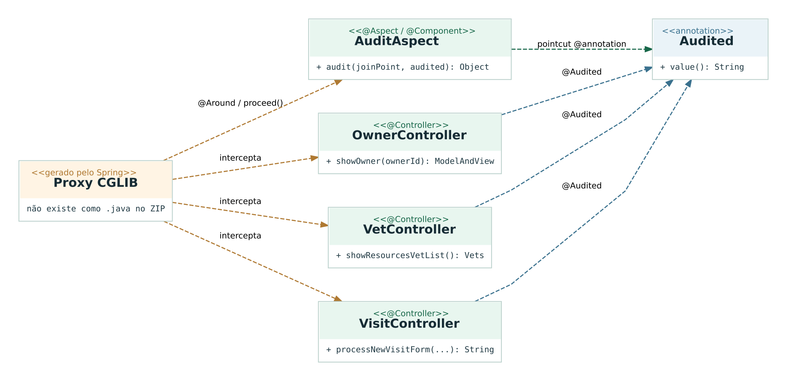
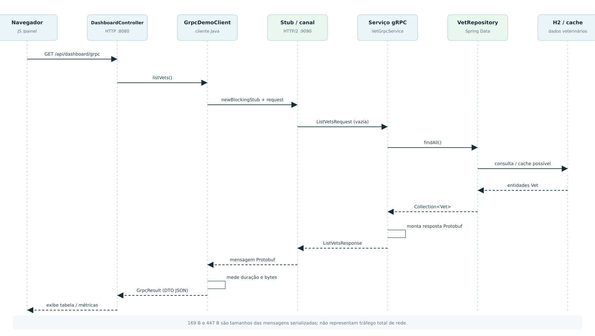
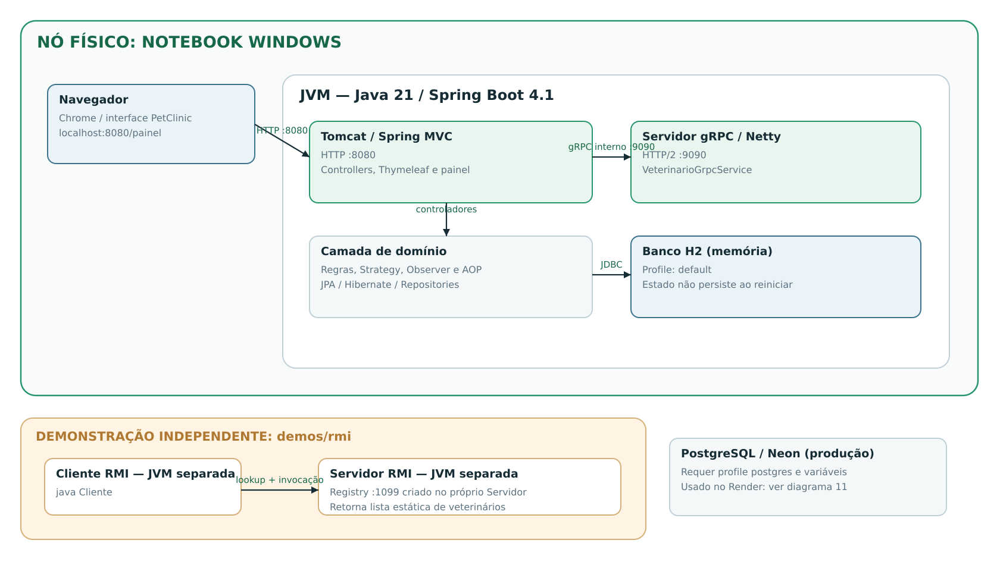
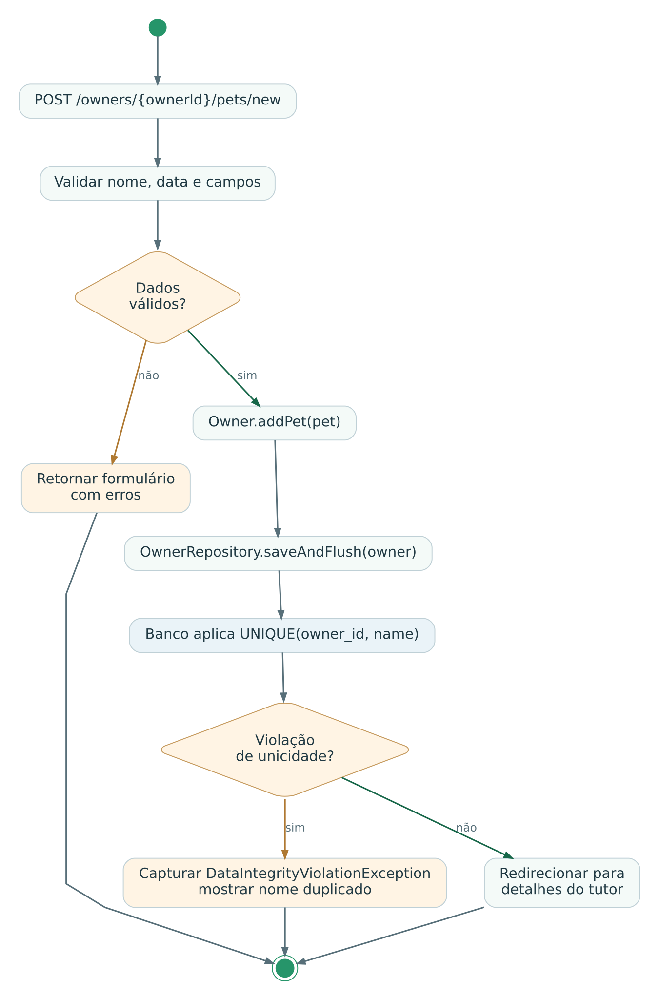
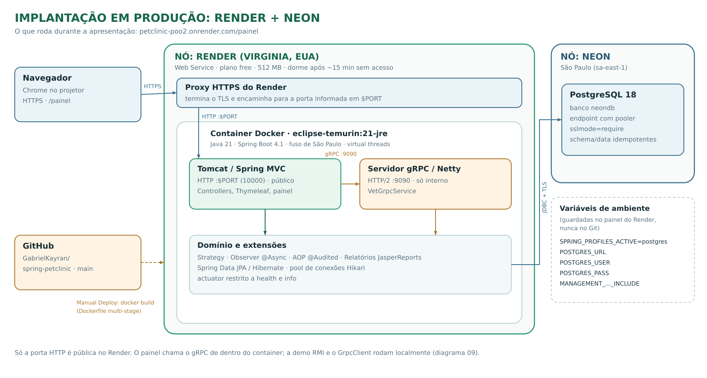

# Spring PetClinic — Modelagem UML

> Documentação técnica produzida a partir do código da versão `GabrielKayran/spring-petclinic` fornecida ao grupo. Não é uma apresentação de slides.

**Projeto-base:** https://github.com/GabrielKayran/spring-petclinic

## Organização

- `svg/` — diagramas prontos para visualizar no GitHub, incorporar no README e abrir em apresentações.
- `puml/` — fonte em PlantUML para editar a modelagem (pode ter estilo visual diferente do SVG já exportado).
- `dot/` — fonte Graphviz utilizada para renderizar parte dos diagramas estruturais, quando disponível.
- `png/` — alternativa raster para programas que não aceitam SVG.

**Importante:** alterar `.puml` ou `.dot` não atualiza automaticamente as imagens. Depois da edição, gere/exporte novamente o `.svg` correspondente.

## Índice

| Nº | Diagrama | Visualização | Fonte PlantUML |
|---|---|---|---|
| 01 | Casos de uso | [SVG](svg/01_casos_de_uso.svg) · [PNG](png/01_casos_de_uso.png) | [PlantUML](puml/01_casos_de_uso.puml) |
| 02 | Classes do domínio | [SVG](svg/02_classes_dominio.svg) · [PNG](png/02_classes_dominio.png) | [PlantUML](puml/02_classes_dominio.puml) |
| 03 | Componentes da arquitetura | [SVG](svg/03_componentes_arquitetura.svg) · [PNG](png/03_componentes_arquitetura.png) | [PlantUML](puml/03_componentes_arquitetura.puml) |
| 04 | Sequência: registro de visita | [SVG](svg/04_sequencia_registro_visita.svg) · [PNG](png/04_sequencia_registro_visita.png) | [PlantUML](puml/04_sequencia_registro_visita.puml) |
| 05 | Classes: Strategy | [SVG](svg/05_classes_strategy.svg) · [PNG](png/05_classes_strategy.png) | [PlantUML](puml/05_classes_strategy.puml) |
| 06 | Classes: Observer | [SVG](svg/06_classes_observer.svg) · [PNG](png/06_classes_observer.png) | [PlantUML](puml/06_classes_observer.puml) |
| 07 | Classes: Spring AOP | [SVG](svg/07_classes_aop.svg) · [PNG](png/07_classes_aop.png) | [PlantUML](puml/07_classes_aop.puml) |
| 08 | Sequência: gRPC | [SVG](svg/08_sequencia_grpc.svg) · [PNG](png/08_sequencia_grpc.png) | [PlantUML](puml/08_sequencia_grpc.puml) |
| 09 | Implantação | [SVG](svg/09_implantacao_execucao_local.svg) · [PNG](png/09_implantacao_execucao_local.png) | [PlantUML](puml/09_implantacao_execucao_local.puml) |
| 10 | Atividade: cadastro de pet | [SVG](svg/10_atividade_cadastro_pet.svg) · [PNG](png/10_atividade_cadastro_pet.png) | [PlantUML](puml/10_atividade_cadastro_pet.puml) |
| 11 | Implantação em produção: Render + Neon | [SVG](svg/11_implantacao_producao_render_neon.svg) · [PNG](png/11_implantacao_producao_render_neon.png) | [PlantUML](puml/11_implantacao_producao_render_neon.puml) |

## Diagramas

### 01 — Casos de uso

Interação do usuário com a aplicação, sem assumir papéis/autenticação.

[Ver SVG](svg/01_casos_de_uso.svg) · [Editar PlantUML](puml/01_casos_de_uso.puml)

### 02 — Classes do domínio

Entidades, herança e relacionamentos persistidos.

[Ver SVG](svg/02_classes_dominio.svg) · [Editar PlantUML](puml/02_classes_dominio.puml)

### 03 — Componentes da arquitetura

Interfaces web, controllers, repositórios, banco e extensões.

[Ver SVG](svg/03_componentes_arquitetura.svg) · [Editar PlantUML](puml/03_componentes_arquitetura.puml)

### 04 — Sequência: registro de visita

Cadastro, persistência, eventos assíncronos e auditoria.

[Ver SVG](svg/04_sequencia_registro_visita.svg) · [Editar PlantUML](puml/04_sequencia_registro_visita.puml)

### 05 — Classes: Strategy

Algoritmos alternativos de cálculo do preço da consulta.

[Ver SVG](svg/05_classes_strategy.svg) · [Editar PlantUML](puml/05_classes_strategy.puml)

### 06 — Classes: Observer

Publicação de evento de visita e listener @Async.

[Ver SVG](svg/06_classes_observer.svg) · [Editar PlantUML](puml/06_classes_observer.puml)

### 07 — Classes: Spring AOP

Anotações, proxies, pointcut e advice de auditoria.

[Ver SVG](svg/07_classes_aop.svg) · [Editar PlantUML](puml/07_classes_aop.puml)

### 08 — Sequência: gRPC

Requisição HTTP ao painel e chamada gRPC interna.

[Ver SVG](svg/08_sequencia_grpc.svg) · [Editar PlantUML](puml/08_sequencia_grpc.puml)

### 09 — Implantação (execução local)

Ambiente de desenvolvimento: navegador, JVM, Tomcat, gRPC, H2 e demonstração RMI isolada. A produção está no diagrama 11.

[Ver SVG](svg/09_implantacao_execucao_local.svg) · [Editar PlantUML](puml/09_implantacao_execucao_local.puml)

### 10 — Atividade: cadastro de pet

Fluxo de validação e exceção de duplicidade no cadastro.

[Ver SVG](svg/10_atividade_cadastro_pet.svg) · [Editar PlantUML](puml/10_atividade_cadastro_pet.puml)

### 11 — Implantação em produção: Render + Neon

O que roda na apresentação: container Docker no Render (só a porta HTTP é pública), gRPC interno e PostgreSQL no Neon.

[Ver SVG](svg/11_implantacao_producao_render_neon.svg) · [Editar PlantUML](puml/11_implantacao_producao_render_neon.puml)

## Rastreabilidade: UML ↔ Código

Os diagramas foram interpretados e modelados a partir das classes do fork. Estes são os pontos de partida para conferir e atualizar a documentação ao modificar o projeto.

| Diagrama | Evidências no código |
|---|---|
| 01 — Casos de uso | [OwnerController.java](../../src/main/java/org/springframework/samples/petclinic/owner/OwnerController.java), [VisitController.java](../../src/main/java/org/springframework/samples/petclinic/owner/VisitController.java), [VetController.java](../../src/main/java/org/springframework/samples/petclinic/vet/VetController.java) |
| 02 — Classes do domínio | [Owner.java](../../src/main/java/org/springframework/samples/petclinic/owner/Owner.java), [Pet.java](../../src/main/java/org/springframework/samples/petclinic/owner/Pet.java), [Visit.java](../../src/main/java/org/springframework/samples/petclinic/owner/Visit.java) |
| 03 — Componentes | [PetClinicApplication.java](../../src/main/java/org/springframework/samples/petclinic/PetClinicApplication.java), [PainelController.java](../../src/main/java/org/springframework/samples/petclinic/painel/PainelController.java) |
| 04 — Sequência da visita | [VisitController.java](../../src/main/java/org/springframework/samples/petclinic/owner/VisitController.java), [LembreteVisitaListener.java](../../src/main/java/org/springframework/samples/petclinic/lembrete/LembreteVisitaListener.java) |
| 05 — Strategy | [PrecoConsultaStrategy.java](../../src/main/java/org/springframework/samples/petclinic/preco/PrecoConsultaStrategy.java), [PrecoConsultaService.java](../../src/main/java/org/springframework/samples/petclinic/preco/PrecoConsultaService.java) |
| 06 — Observer | [VisitaRegistradaEvent.java](../../src/main/java/org/springframework/samples/petclinic/lembrete/VisitaRegistradaEvent.java), [LembreteVisitaListener.java](../../src/main/java/org/springframework/samples/petclinic/lembrete/LembreteVisitaListener.java) |
| 07 — AOP | [Auditado.java](../../src/main/java/org/springframework/samples/petclinic/auditoria/Auditado.java), [AuditoriaAspect.java](../../src/main/java/org/springframework/samples/petclinic/auditoria/AuditoriaAspect.java) |
| 08 — Sequência gRPC | [GrpcDemoCliente.java](../../src/main/java/org/springframework/samples/petclinic/painel/GrpcDemoCliente.java), [VeterinarioGrpcService.java](../../src/main/java/org/springframework/samples/petclinic/grpc/VeterinarioGrpcService.java), [veterinarios.proto](../../src/main/protobuf/veterinarios.proto) |
| 09 — Implantação | [application.properties](../../src/main/resources/application.properties), [demos/rmi/Servidor.java](../../demos/rmi/Servidor.java) |
| 10 — Cadastro de pet | [PetController.java](../../src/main/java/org/springframework/samples/petclinic/owner/PetController.java), [PetClinicConcurrencyTests.java](../../src/test/java/org/springframework/samples/petclinic/PetClinicConcurrencyTests.java) |
| 11 — Produção | [Dockerfile](../../Dockerfile), [render.yaml](../../render.yaml), [application-postgres.properties](../../src/main/resources/application-postgres.properties) |

**Nota:** os links acima são relativos à raiz do repositório. Eles funcionarão depois que a pasta `docs/uml` for colocada no projeto Spring PetClinic.

## Limites da modelagem (confirmados no código)

1. Não há associação direta de `Visit` para `Vet` nas entidades Java.
2. O valor calculado pelo padrão Strategy é exibido na interface; não é persistido no objeto `Visit`.
3. O RMI clássico está em `demos/rmi`, independente da aplicação principal. O gRPC está integrado ao backend Spring.
4. O H2 da configuração local e dos testes é um banco em memória (dados reiniciam com a aplicação). Em produção o banco é o PostgreSQL no Neon (diagrama 11).
5. Os eventos `Observer` e `@Async` simulam o lembrete com espera; não há envio real de e-mail/SMS.
6. A aplicação de exemplo não implementa autenticação ou papéis de usuário para as funções mostradas.
7. Na apresentação acadêmica, diferenciar o código do PetClinic original, as extensões do fork e as alterações efetivamente realizadas pelo grupo.

## Relação com a disciplina

**Aula conceitual:** diagramas 01–07, com o 09 como apoio.

**Aula técnica:** diagramas 04, 05, 06, 07, 08, 09, 10 e 11.

Ao tratar do item 7.3 da ementa, associar os artefatos a requisitos, análise/modelagem, arquitetura, comportamento, implantação e validação. O conjunto representa a implementação estudada; não constitui, sozinho, evidência de desenvolvimento autoral de todas as fases.

## Arquivos editáveis

Edite `.puml` usando PlantUML no VS Code ou outro editor compatível. Para os diagramas com `.dot`, também é possível editar a fonte Graphviz e exportar para SVG (exemplo: `dot -Tsvg diagrama.dot -o diagrama.svg`).

## Créditos e transparência

Projeto analisado: fork `GabrielKayran/spring-petclinic`, derivado do projeto aberto `spring-projects/spring-petclinic`. Os diagramas documentam o comportamento verificado no código e não atribuem a autoria do programa ao grupo.

## Histórico de revisões

- **Revisão para a apresentação:** diagrama 03 atualizado (banco PostgreSQL/Neon, URL do Render e componente de
  relatórios JasperReports); nota do Neon corrigida no 09; novo diagrama 11 (produção); estereótipos corrigidos
  de `<<<<x>>>>` para `<<x>>` (05, 06, 07 e fontes `.dot`); `viewBox` dos SVGs do Graphviz (02, 05, 06, 07, 10)
  ajustado à escala 2.5, porque o navegador mostrava só parte do diagrama; fonte com fallback para Verdana
  (DejaVu Sans não vem instalada no Windows).
