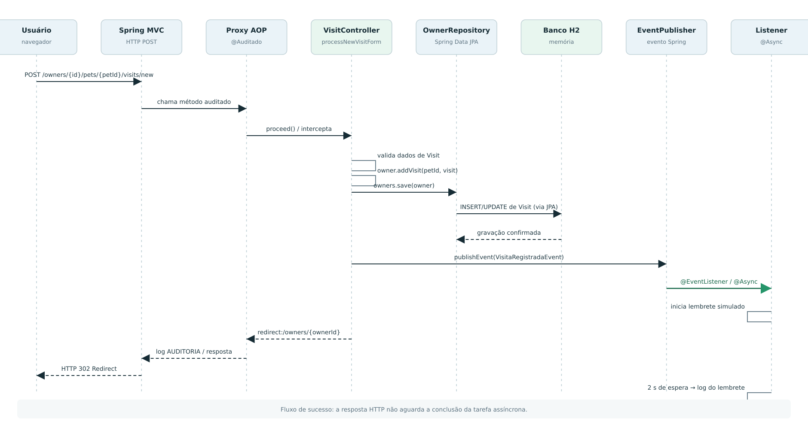

# Diagramas UML

[← Início](Home.md)

Os 11 diagramas ficam em [`docs/uml`](../uml/README.md), com a fonte PlantUML (`puml/`) e as imagens exportadas (`svg/`, `png/`). O painel também os mostra na seção **U**, porque o Dockerfile copia `docs/uml/svg` para dentro da imagem.

| Nº | Diagrama | Ligação com o código | Página da wiki |
|---|---|---|---|
| 01 | [Casos de uso](../uml/svg/01_casos_de_uso.svg) | controllers de `owner`, `vet`, `report` | [Arquitetura](Arquitetura-e-pacotes.md) |
| 02 | [Classes do domínio](../uml/svg/02_classes_dominio.svg) | `model`, `owner`, `vet` | [Domínio e banco](Modelo-de-dominio-e-banco.md) |
| 03 | [Componentes da arquitetura](../uml/svg/03_componentes_arquitetura.svg) | todos os pacotes | [Arquitetura](Arquitetura-e-pacotes.md) |
| 04 | [Sequência: registro de visita](../uml/svg/04_sequencia_registro_visita.svg) | `VisitController` → evento → `VisitReminderListener` | [Observer](Observer-e-Async.md) |
| 05 | [Classes: Strategy](../uml/svg/05_classes_strategy.svg) | pacote `pricing` | [Strategy](Strategy-preco-da-consulta.md) |
| 06 | [Classes: Observer](../uml/svg/06_classes_observer.svg) | pacote `reminder` | [Observer](Observer-e-Async.md) |
| 07 | [Classes: Spring AOP](../uml/svg/07_classes_aop.svg) | pacote `audit` | [AOP](AOP-auditoria.md) |
| 08 | [Sequência: gRPC](../uml/svg/08_sequencia_grpc.svg) | `GrpcDemoClient` → `VetGrpcService` → `VetRepository` | [RMI e gRPC](RMI-e-gRPC.md) |
| 09 | [Implantação local](../uml/svg/09_implantacao_execucao_local.svg) | `application.properties`, H2, portas 8080/9090 | [Como executar](Como-executar.md) |
| 10 | [Atividade: cadastro de pet](../uml/svg/10_atividade_cadastro_pet.svg) | `PetController.processCreationForm` | [Concorrência](Concorrencia-e-virtual-threads.md#condição-de-corrida-pet-com-nome-duplicado) |
| 11 | [Implantação: Render + Neon](../uml/svg/11_implantacao_producao_render_neon.svg) | `Dockerfile`, `render.yaml` | [Como executar](Como-executar.md#produção-render--neon) |

## Exemplo: sequência do registro de visita

Lendo junto com o código:

1. O navegador envia `POST /owners/1/pets/1/visits/new`.
2. O proxy do `VisitController` passa pelo `AuditAspect` ([AOP](AOP-auditoria.md)).
3. `owners.save(owner)` grava a visita (linha 116).
4. `events.publishEvent(...)` publica o `VisitRegisteredEvent` (linha 118).
5. O Spring entrega o evento ao `VisitReminderListener` num executor `@Async` e a requisição já responde com o redirect.
6. Dois segundos depois, em outra thread, o lembrete é "enviado".

## Editando um diagrama

Alterar o `.puml` não atualiza as imagens. Depois de editar, exporte de novo o `.svg` (e o `.png`), por exemplo com a extensão PlantUML do VS Code ou com `java -jar plantuml.jar -tsvg docs/uml/puml/04_sequencia_registro_visita.puml`.
